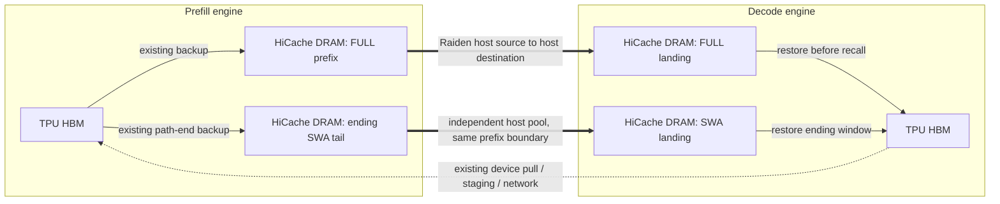

# Victim prefix cache: design and reliability review

Written 2026-10-26. Reviewed SGLang `6c60fd77b79f9dbcc5a70d49489a2e00080317f8`
and native tpu-sync `759530c7fb0a5f7c38114187e1bcde745f709f24`. The local corrected
SGLang revision is `f2d8c3e58ea6a47a89ead8f9f4a4a81a1eab629d`, authored by
`alisachen-google`. GitHub publication of that revision is pending authentication.

Design website (published and saved privately):
<https://pd-victim-cache-design-20261026.groovyteal9.chatgpt.site>

Sites source commit: `fa0bf7ea54f09262f506276d76e7939dff9af7c3`. The static source
is retained independently of the SGLang feature commit. Desktop and mobile
browser checks pass. The site explains the original commit, the corrected
revision, and remaining validation/dependency limits; it claims no model
performance gain.

## Design

Prefill remains the primary prefix cache. When its FULL or SWA host tier is
under pressure, it exports an old routed branch to the Decode that served that
session. Decode stores pushed victims as host-only radix nodes. Ordinary
generation skips persistent Decode cache insertion under this opt-in policy.
After successful storage, Prefill prioritizes its local copy for eviction;
it does not synchronously free it at the network completion boundary.

The direct DRAM-to-DRAM optimization applies to **victim export**. Reverse recall
still restores Decode DRAM into Decode HBM, then uses the device-oriented P/D
engines to receive into Prefill HBM. A complete local Prefill host hit restores
locally. With a partial host hit, the pull covers the range after the resident
device prefix and may transfer host-backed overlap too.

A reusable hybrid prefix ending at M requires FULL KV `[0, M)` and the
page-aligned SWA tail ending at the same M. FULL-only demotion cannot establish
a reusable GPT-OSS victim. Both components must succeed on every TP/CP rank
before publication.

## Code map

| Area | Responsibility |
| --- | --- |
| `sglang_tpu/pd_victim_push.py` | Track the serving Decode per cached branch; select and pin victims; admit host landings; settle FULL/SWA operations; insert host-only victims; prioritize the local LRU copy. |
| `sglang_tpu/raiden_transfer.py` | Reuse existing host managers; open a positive control port; forward `source="host"`, `destination="host"`, named host IDs and parallelism; retain terminal reports per request. |
| `sglang_tpu/disaggregation/raiden/{serde,state,sender,receiver}.py` | Carry metadata and track independent read sessions. Payloads do not travel in ZMQ frames. |
| `sglang_tpu/disaggregation/raiden/{prefix_offer,prefix_pull}.py` | Select a usable FULL/SWA prefix, agree on missing ranges, receive into Prefill HBM, and retain the inserted path lock until admission owns it. |
| `sglang_tpu/pd_decode_window_restore.py` | Restore the host-only ending window before Decode advertises its device pages. |
| `sglang_tpu/pd_decode_swa_hicache.py` | Construct and account for the FULL/SWA host pools and path-end windows. |
| Generic P/D queues and base interfaces | Default no-op backend seams for prefix preparation, commit, cleanup, and memory ownership. |

The user's selected GitHub anchor is
`test/registered/unit/disaggregation/test_raiden_failure_handling.py`.
Its original additions adapt existing fixtures: initialize `_send_reads`, bind
`_prefix_pull_open_locked`, and set `decode_prefix_puller=None`. The spill
mechanism itself lives in the production files above.

## Confirmed findings and corrections

### P1: refused victim completion notices leaked

`DecodeReceiver.step` called `_finish_agreed` only when a landing existed.
Refused offers can still produce failure DONE notices after source registration
expiry. With no landings, those notices accumulated indefinitely. The regression
retained all 100 injected orphan notices on the reviewed revision.

Correction: run completion cleanup every agreement round. With no landings it
returns before any landing collective. Both cleanup cases pass after the fix.

### P1: rank-local receive retirement changed cache eviction decisions

An abandoned reverse receive can finish on TP0 before TP1. Originally the next
recall allocation computed its shortfall locally: TP0 retained a 64-token
cached prefix while TP1 evicted it. A real two-rank Gloo test with the actual
CPU radix cache and allocator reproduced the divergent cache contents.

Correction: MIN-agree reserve eligibility, MAX-agree FULL/SWA shortfalls before
eviction, MIN-agree allocation success, and roll back successful local
allocations if another rank fails. The regression now passes. This establishes
CPU cache consistency, not proof of hardware hang freedom.

### P1: abandoned reads were invisible to idle/reset; empty queues stopped polling

After the last recall request aborted, `_zombies` retained destination pages but
the Scheduler could report fully idle. A real `flush_cache` invocation cleared
the tree and allocator while a receiver still had pending native writes.
With no queued sender to poll, a completed receive could also remain cached as
pending forever. Paused Prefill loops skipped the normal bootstrap advancement.

Corrections:

- Set a sticky external-read ownership flag only after all-rank allocation
  succeeds. Clear it only in a rank-synchronous cleanup step after MAX-agreeing
  whether any rank still owns destinations. Keep idle queries pure.
- Poll native completion and reap deferred pages in empty bootstrap ticks and
  in explicit paused-loop cleanup ticks, without admitting new requests.
- Include active host exports in `VictimPrefixPuller`'s pending ownership and
  settle them in control ticks, without starting new exports while paused.
- Keep flush non-idle while ownership remains. Refuse memory release if native
  reads still own destinations.

Four recall idle/reset/paused regressions and the host-export ownership cases
pass. An earlier idea to reap pages inside the idle query was rejected: it
could make one rank enter cache reset while another rank refused it.

## Remaining native progress limitation

The native session timeout marks a transfer draining but does not interrupt a
blocked TCP operation. An owned-child CPU probe paused its consumer after the
first block of a 128 MiB host transfer. With `timeout_s=0.2`, the producer was
still pending after one second; resuming the child allowed failure to settle.
With existing native socket I/O timeouts set to 0.1 seconds for the fault probe,
the producer failed while the consumer remained paused. Both probes resumed,
drained and exited their owned child; live TPU processes were untouched.

Use finite native handshake, payload and ACK I/O timeouts before starting both
roles; the SGLang README lists the existing knobs and preserves explicitly set
values. The 0.1-second value above is only a fault-probe setting. A per-I/O
timeout is not a strict deadline for an entire transfer making slow progress.
Never free native-owned memory merely because a Python timer elapsed.

The existing `release_memory_occupation` control RPC asserts full idleness
before releasing memory. Calling it while busy can terminate the Scheduler;
that precondition predates this feature. Operators must wait for ownership to
drain before requesting release. The guarded `flush_cache` path returns false
while external ownership remains.

## Validation and artifact placement

- 253 existing SGLang tests plus 169 subtests passed across the touched recall,
  victim, idle, polling, priority, timeout and flush paths.
- Nine additional regression cases are retained under
  `tests/pd_victim_review/` **in this repository only**; one uses a real
  two-rank Gloo group.
- The earlier native build passed eight real CPU host loopback tests and seven
  Python host/API tests. This review's fault probes use the same native core.
- Ruff's selected repository checks, formatting and diff checks pass. No new
  SGLang test function was added; existing fixtures were adapted to the updated
  interfaces.
- `test/manual/tpu/bench_pd_victim_host.py` is removed from the SGLang commit and
  retained locally. Benchmark outputs remain local too.
- No live TPU model run or cross-host validation was performed. The strict TPU
  support-matrix scan retains eight existing registration metadata failures.

The local review is substantially safer after the confirmed fixes. It should
still be treated as experimental until native I/O settings and live TPU
abort/pause/flush paths are validated on the intended pair.
