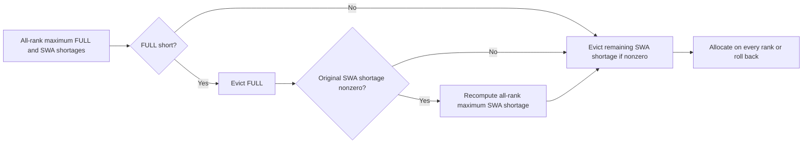

# SGLang torchtpu PR 2234 review

- Reviewed: 2026-11-20, by alisachen-google.
- PR: [Recheck SWA space after full host-cache eviction](https://github.com/sgl-project/sglang-torchtpu/pull/2234).
- Head: `7555b3dc355fb74c755d53272d71d66b7523907f`.
- Diff/merge base: `e1c3e4369b5928de0ea4a073a152c375ec9a112b` (`main`); one commit.
- Scope: both changed files, admission/allocation callers, rank agreement, and actual tree/pool freeing. Open at review time.

**Recommendation: approve the code change. No actionable defect found.** Real distributed and TPU validation remain unverified; this is a review recommendation, not a submitted GitHub approval.

## What it does

Prefill spills cold KV prefixes into Decode's host RAM. Hybrid models need both the full-attention prefix (FULL) and the sliding-window tail (SWA). Before accepting a spill, Decode makes room in both pools.

Previously, the receiver measured both shortages, evicted FULL, then evicted the *original* SWA shortage. Deleting a FULL host leaf also deletes its SWA component, so the second eviction could throw away useful windows unnecessarily. This can reduce later cache reuse; it is not a change to attention numerics or transfer bytes.

Example: the incoming spill needs eight FULL slots and four SWA slots, and both pools are full. FULL eviction frees eight FULL slots **and four SWA slots**. Previously another four SWA slots were evicted. Now the receiver measures the remaining shortage and skips that unnecessary eviction.

The new flow is:



## Verified non-issues

- **Collective ordering:** both branches guarding the new collective use the initial MAX-reduced values, identical on every rank. A rank with enough local space still participates when a peer is short. The recheck also uses MAX, preserving common eviction amounts. See [receiver lines 171–196](https://github.com/sgl-project/sglang-torchtpu/blob/7555b3dc355fb74c755d53272d71d66b7523907f/sglang_tpu/disaggregation/decode_dram_offload/decode_dram_victim_receiver.py#L171-L196) and [RankLockstep](https://github.com/sgl-project/sglang-torchtpu/blob/7555b3dc355fb74c755d53272d71d66b7523907f/sglang_tpu/disaggregation/decode_dram_offload/rank_lockstep.py#L38-L43).
- **The recheck sees released capacity:** `evict_host` drives tree eviction and immediately drains the returned frees. A host-leaf eviction includes every component; FULL duplicate reclamation can instead free only FULL, which is exactly why measuring the remainder is appropriate. See [evict_host](https://github.com/sgl-project/sglang-torchtpu/blob/7555b3dc355fb74c755d53272d71d66b7523907f/python/sglang/srt/mem_cache/unified_radix_cache.py#L1449-L1459) and [host-leaf deletion](https://github.com/sgl-project/sglang-torchtpu/blob/7555b3dc355fb74c755d53272d71d66b7523907f/python/sglang/srt/mem_cache/unified_cache/unified_tree_core.py#L2068-L2093).
- **Full-only models:** zero SWA demand keeps the extra branch unreachable, so an absent SWA pool is not dereferenced. SWA-only pressure retains the previous one-collective behavior.
- **Failure cleanup:** the later `alloc_host_pages_agreed` still rejects allocation on all ranks and frees successful local allocations if a peer cannot allocate. The patch does not bypass pins or change native transfer ownership.
- **Plugin direction:** production changes stay under `sglang_tpu/`; no new shared-core TPU branch or hook is introduced.

## Evidence and limits

The PR adds two unit tests: FULL eviction completely releases the window, and a peer retains a larger shortage. I additionally ran [probe_pr2234_recheck.py](../../tests/pd_victim_review/probe_pr2234_recheck.py), which extracts the actual method and executes it with two threads and synchronized simulated MAX collectives. All **six cases passed** at the reviewed head. Against the base method, the three collateral-release cases failed while three unchanged cases passed. This covers the asymmetric local-capacity branch missing from the added tests.

```bash
python3 tests/pd_victim_review/probe_pr2234_recheck.py \
  /path/to/head/sglang_tpu/disaggregation/decode_dram_offload/decode_dram_victim_receiver.py
```

This probe uses simulated pools and collectives, not real Gloo, the production allocator, or TPU. This review environment has no torch/msgspec/SGLang installation; I did not rerun the upstream unit suite. The author's reported 160 tests and 113 subtests are author evidence. GitHub's [base CI run](https://github.com/sgl-project/sglang-torchtpu/actions/runs/44149658212) has successful CPU shards. In the [TPU workflow](https://github.com/sgl-project/sglang-torchtpu/actions/runs/44149657880), build, unit-test and e2e-test were **skipped**, despite a successful finish gate.

The added CPU collective occurs only when both initial shortages are nonzero. No latency or cache-hit improvement was measured. A useful follow-up is a real two-rank pressure test with unequal free capacity and host pins, followed by a spill/recall workload on TPU.

## Existing discussion

The [existing automated review](https://github.com/sgl-project/sglang-torchtpu/pull/2234#pullrequestreview-5944881314) reported no high-confidence issue. No substantive unresolved inline finding appeared in the fetched discussion. This PR is independent of #2235's metadata transport.
